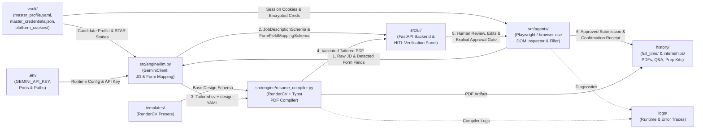

# JobApplier-Core Architecture

**JobApplier-Core** is a local-first, Human-in-the-Loop (HITL) job application automation system. Its architecture enforces a strict security boundary between **tracked source code/templates** and **gitignored personal data/artifacts**, ensuring no PII, credentials, or application history can ever leak to version control.

---

## Component Map & Boundaries

| Directory / Module | Tracked in Git? | Primary Responsibility | Strict Boundaries |
| :--- | :--- | :--- | :--- |
| **`src/engine/`** | Yes | Core intelligence & document compilation (`llm.py`, `resume_compiler.py`, future tailoring/archival logic). | Never performs direct browser DOM clicks or stores PII in source code; accepts paths/objects injected at runtime. |
| **`src/agents/`** | Yes | Browser automation via Playwright and `browser-use`; inspects ATS forms, loads `storageState.json` cookies, fills approved values. | Must never submit an application without an explicit HITL approval token from `src/ui/`; never logs raw secrets. |
| **`src/ui/`** | Yes | Local FastAPI backend (`API_PORT=8000`) and HITL verification panel (`UI_PORT=8501`) for reviewing/editing form mappings and tailored resumes. | Localhost-bound only; acts as the mandatory human checkpoint between `src/engine/` proposals and `src/agents/` submission. |
| **`templates/`** | Yes | Reusable RenderCV YAML layout/theme presets and interview prep Markdown skeletons. | Contains zero personal details, emails, phone numbers, or candidate-specific experience. |
| **`scripts/`** | Yes | Developer tooling such as pre-commit hook scripts and setup installers (`setup_hooks.ps1`, `setup_hooks.sh`). | Must never hardcode credentials or reference real user data. |
| **`vault/`** | **No (Gitignored)** | Private candidate source of truth: `master_profile.yaml`, `master_credentials.json`, `portfolio_assets/`, `platform_cookies/`. | Never committed or copied into `src/` or `templates/`; accessed only via runtime paths configured in `.env`. |
| **`history/`** | **No (Gitignored)** | Immutable per-application archive split into `history/full_time/` and `history/internships/` (tailored YAML/PDF, JD snapshot, submitted Q&A, prep kit). | Write-once archival outputs per job run; excluded from git and pre-commit staged paths. |
| **`logs/`** | **No (Gitignored)** | Runtime execution logs, Typst/RenderCV error traces, and sanitized agent diagnostics. | Local debugging only; must scrub credentials/tokens before writing to disk. |

---

## Implemented Phase 1 Modules

- **`src/engine/llm.py`**:
  - Wraps the official `google-genai` SDK via `GeminiClient`.
  - Enforces supported models (`GEMINI_PRO = "gemini-1.5-pro"`, `GEMINI_FLASH = "gemini-1.5-flash"`) via `validate_model()`.
  - Loads `GEMINI_API_KEY` through `python-dotenv` (`load_gemini_api_key()`), raising `MissingGeminiCredentialsError` when missing or set to `your_gemini_api_key_here`.
  - Produces validated Pydantic v2 structured JSON outputs (`JobDescriptionSchema`, `FormFieldMappingSchema`) via `generate_structured()`, `parse_job_description()`, and `map_form_field()`.
- **`src/engine/resume_compiler.py`**:
  - Validates `rendercv` CLI availability via `ensure_rendercv_installed()` (raising `RenderCVNotInstalledError` if missing).
  - Runs `rendercv render` (Typst backend) inside a `tempfile.TemporaryDirectory` via `compile_resume(yaml_path, output_pdf_path)` so intermediate `.typ` and auxiliary files never pollute the repository.
  - Verifies `%PDF-` magic header and non-zero file size before returning `True`; logs errors and returns `False` on schema or subprocess failures.

---

## End-to-End Data Flow

### Mermaid Diagram



### ASCII Pipeline Overview

```text
  [.env] + [vault/master_profile.yaml & platform_cookies/] + [templates/]
       |                       |                                  |
       v                       v                                  v
  +----------------------------------------------------------------------+
  | 1. INSPECT (src/agents/ via Playwright / browser-use)                |
  |    - Load storageState.json session cookies                          |
  |    - Scrape Job Description & extract live ATS form field metadata   |
  +----------------------------------------------------------------------+
                               |
                               v
  +----------------------------------------------------------------------+
  | 2. REASON & TAILOR (src/engine/llm.py + Gemini 1.5 Pro/Flash)        |
  |    - Parse JD -> JobDescriptionSchema                                |
  |    - Map fields + work_authorization + story_bank -> FormFieldMapping|
  |    - Generate tailored RenderCV YAML (cv + design)                   |
  +----------------------------------------------------------------------+
                               |
                               v
  +----------------------------------------------------------------------+
  | 3. COMPILE (src/engine/resume_compiler.py -> RenderCV + Typst)       |
  |    - Validate YAML schema & render PDF in isolated temp directory    |
  |    - Verify %PDF- header and copy tailored PDF artifact              |
  +----------------------------------------------------------------------+
                               |
                               v
  +----------------------------------------------------------------------+
  | 4. VERIFY (src/ui/ -> Local FastAPI + HITL Verification Panel)       |
  |    - Display side-by-side form values, screening answers & PDF       |
  |    - Human edits values & clicks explicit Approve before submit      |
  +----------------------------------------------------------------------+
                               |
                               v
  +----------------------------------------------------------------------+
  | 5. SUBMIT & ARCHIVE (src/agents/ -> history/ + logs/)                |
  |    - Fill approved fields & upload tailored PDF                      |
  |    - Archive bundle in history/full_time/ or history/internships/    |
  |    - Record sanitized execution & error traces in logs/              |
  +----------------------------------------------------------------------+
```

---

## Configuration Contract (`.env`)

Runtime configuration is read from `.env` (copied from `.env.example`, never committed):

| Variable | Default in `.env.example` | Purpose |
| :--- | :--- | :--- |
| `UI_PORT` | `8501` | Port for the local HITL Verification Panel UI. |
| `API_PORT` | `8000` | Port for the local FastAPI orchestration service. |
| `VAULT_PATH` | `./vault` | Root directory for private profile, encrypted credentials, and cookies. |
| `TEMPLATES_PATH` | `./templates` | Directory for tracked RenderCV base themes and templates. |
| `HISTORY_PATH` | `./history` | Root directory for archived applications (`full_time/`, `internships/`). |
| `STORAGE_STATE_PATH` | `./vault/platform_cookies/storageState.json` | Default Playwright browser session storage file path. |
| `GEMINI_API_KEY` | `your_gemini_api_key_here` | Google Gemini API credential (validated by `load_gemini_api_key`). |

---

## Security & Leak Prevention Controls

1. **Git Exclusion (`.gitignore`)**: Ignores `vault/`, `history/`, `logs/`, `.env`, `.env.*` (except `.env.example`), `*.sqlite`, `*.db`, `storageState.json`, `__pycache__/`, and `.venv/`.
2. **Pre-Commit Gate (`scripts/hooks/pre-commit`)**: Runs before every commit to inspect staged file names and diff additions, hard-blocking API key prefixes (`AIzaSy...`, `sk-...`), email patterns, phone numbers, and accidental staging of protected directories.
3. **Isolation in Compilation (`resume_compiler.py`)**: All RenderCV/Typst builds execute in ephemeral OS temp directories so candidate YAML/PDF artifacts are never written into tracked folders.
